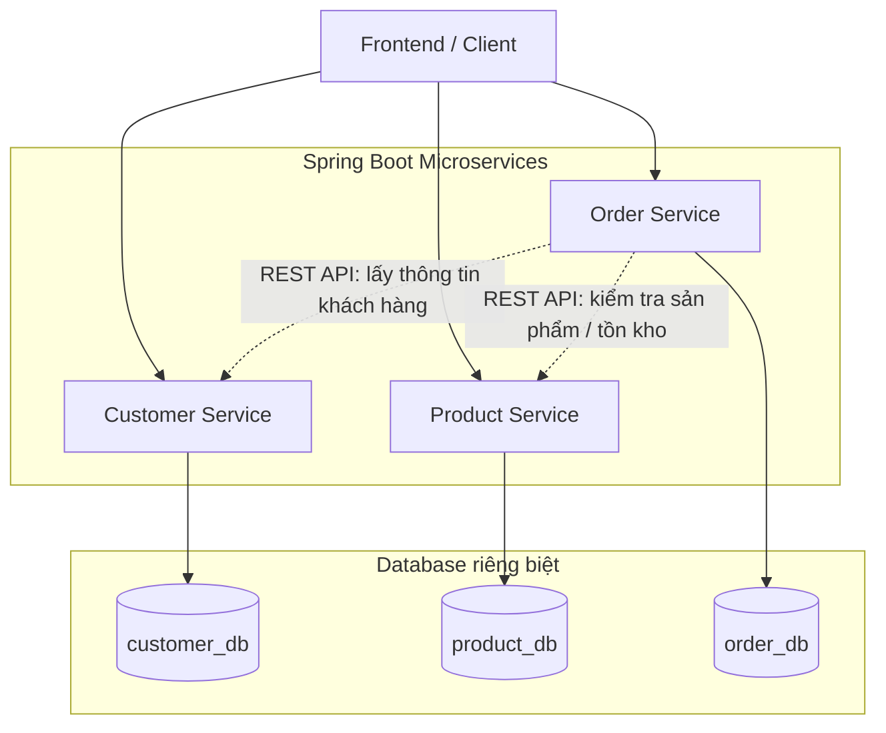

# I: Thiết kế kiến trúc hệ thống E-commerce-System 

# 1. Sơ đồ kiến trúc Microservices

## 2. Giải thích sơ đồ

- **Customer Service:** Quản lý khách hàng và dữ liệu trong `customer_db`.
- **Product Service:** Quản lý sản phẩm, giá bán và tồn kho trong `product_db`.
- **Order Service:** Quản lý đơn hàng trong `order_db`.
- Các service giao tiếp thông qua REST API, không gọi trực tiếp code của nhau.
- Mỗi service chỉ quản lý database của chính nó.

## 3. Thiết kế entity

- **Customer Entity:** gồm các thuộc tính: id, fullName, email, password, address
- **Product Entity:** gồm các thuộc tính: id, name, price, stockQuantity, description
- **Order Entity:** gồm các thuộc tính: id, customerId, orderDate, totalAmount, orderStatus

## 4. Thiết kế API

### 4.1. Customer Service APIs

| Phương thức | Endpoint | Mô tả | Request Body / Params | Response mẫu |
| :--- | :--- | :--- | :--- | :--- |
| **POST** | `/api/v1/customers` | Tạo mới khách hàng | `{ "fullName": "Nguyễn Văn A", "email": "a@gmail.com", "password": "123", "address": "Hà Nội" }` | `201 Created` `{ "id": 1, "fullName": "Nguyễn Văn A", ... }` |
| **GET** | `/api/v1/customers` | Lấy danh sách khách hàng | Không có | `200 OK` `[{ "id": 1, ... }]` |
| **GET** | `/api/v1/customers/{id}` | Lấy khách hàng theo ID | Path Variable: `id` | `200 OK` `{ "id": 1, ... }` |
| **PUT** | `/api/v1/customers/{id}` | Cập nhật khách hàng | Path Variable: `id` Body: `{ ... }` | `200 OK` `{ ... }` |
| **DELETE** | `/api/v1/customers/{id}` | Xóa khách hàng | Path Variable: `id` | `204 No Content` |

---

### 4.2. Product Service APIs

| Phương thức | Endpoint | Mô tả | Request Body / Params | Response mẫu |
| :--- | :--- | :--- | :--- | :--- |
| **POST** | `/api/v1/products` | Thêm mới sản phẩm | `{ "name": "Laptop", "price": 15000000, "stockQuantity": 10, "description": "Core i5" }` | `201 Created` `{ "id": 1, ... }` |
| **GET** | `/api/v1/products` | Lấy danh sách sản phẩm | Không có | `200 OK` `[{ "id": 1, ... }]` |
| **GET** | `/api/v1/products/{id}` | Lấy sản phẩm theo ID | Path Variable: `id` | `200 OK` `{ "id": 1, ... }` |
| **PUT** | `/api/v1/products/{id}` | Cập nhật sản phẩm | Path Variable: `id` Body: `{ ... }` | `200 OK` `{ ... }` |
| **DELETE** | `/api/v1/products/{id}` | Xóa sản phẩm | Path Variable: `id` | `204 No Content` |

---

### 4.3. Order Service APIs

| Phương thức | Endpoint | Mô tả | Request Body / Params | Response mẫu |
| :--- | :--- | :--- | :--- | :--- |
| **POST** | `/api/v1/orders` | Tạo mới đơn hàng | `{ "customerId": 1, "totalAmount": 15000000, "orderStatus": "PENDING" }` | `201 Created` `{ "id": 1, ... }` |
| **GET** | `/api/v1/orders` | Lấy danh sách đơn hàng | Không có | `200 OK` `[{ "id": 1, ... }]` |
| **GET** | `/api/v1/orders/{id}` | Lấy đơn hàng theo ID | Path Variable: `id` | `200 OK` `{ "id": 1, ... }` |
| **PUT** | `/api/v1/orders/{id}` | Cập nhật đơn hàng | Path Variable: `id` Body: `{ ... }` | `200 OK` `{ ... }` |
| **DELETE** | `/api/v1/orders/{id}` | Xóa đơn hàng | Path Variable: `id` | `204 No Content` |

## 5. Ranh giới và trách nhiệm của các service
- **Customer Service:** Chịu trách nhiệm quản lý thông tin khách hàng, bao gồm tạo, đọc, cập nhật và xóa khách hàng. Không quản lý thông tin sản phẩm hay đơn hàng.
- **Product Service:** Chịu trách nhiệm quản lý thông tin sản phẩm, bao gồm tạo, đọc, cập nhật và xóa sản phẩm. Không quản lý thông tin khách hàng hay đơn hàng.
- **Order Service:** Chịu trách nhiệm quản lý thông tin đơn hàng, bao gồm tạo, đọc, cập nhật và xóa đơn hàng. Khi cần thông tin khách hàng hoặc sản phẩm, Order Service sẽ gọi REST API của Customer Service và Product Service thay vì truy cập trực tiếp vào cơ sở dữ liệu của họ. Điều này giúp duy trì tính độc lập và tách biệt giữa các service, đồng thời giảm sự phụ thuộc lẫn nhau.
- **Ràng buộc dữ liệu:** Mỗi service có cơ sở dữ liệu riêng, đảm bảo rằng dữ liệu của mỗi service được quản lý và bảo vệ một cách độc lập. Điều này giúp giảm thiểu rủi ro khi một service gặp sự cố hoặc cần bảo trì, vì các service khác vẫn có thể hoạt động bình thường mà không bị ảnh hưởng. Ko được import entity của service khác vào service hiện tại, tránh việc gọi trực tiếp code của nhau.

### 5.1. Lí do Order chỉ lưu thông tin `customerId`
- **Nếu order service lưu thông tin chi tiết của khách hàng sẽ khiến order service bị phụ thuộc vào customer service. Khi customer service thay đổi cấu trúc dữ liệu, order service cũng phải thay đổi theo, dẫn đến việc bảo trì và phát triển trở nên phức tạp hơn.**